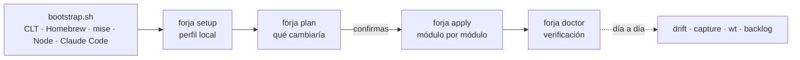

# forja

[](https://github.com/sastiam/forja/actions/workflows/ci.yml)
[](LICENSE)
[](CHANGELOG.md)

Provisionamiento y optimización de estaciones de desarrollo con un solo comando, asistido por Claude Code (macOS primero; Fedora en desarrollo; Raspberry Pi planificado).

## Qué es y para quién

Para quien formatea su Mac (o configura una nueva) y quiere dejarla instalada, configurada y optimizada con un comando, y después mantenerla: detectar desvíos, capturar cambios hechos a mano y diagnosticar problemas. El repo es **público y agnóstico**: no contiene nada personal; tu perfil se genera en tu máquina (`~/.config/forja/`).

## Inicio rápido

```sh
curl -fsSL https://raw.githubusercontent.com/<usuario>/forja/main/bootstrap.sh | sh
```

Opciones: `--dry-run` (solo muestra), `--no-claude` (100 % determinista), `--dir <ruta>`, `--ref <tag|rama>`.

## Cómo funciona



Híbrido: la instalación la hace código determinista (Brewfile por módulo + chezmoi); Claude Code entra para entrevistar, diagnosticar y mantener (desde v0.2.0).

## Comandos

| Comando | Qué hace |
|---|---|
| `forja setup [--no-claude]` | Crea el perfil local (con Claude, skill `forja-onboarding`), luego plan → apply → doctor |
| `forja plan [módulo…] [--json]` | Muestra qué cambiaría; no modifica nada |
| `forja apply [módulo…] [--yes] [--dry-run] [--force] [--revert]` | Aplica módulos resolviendo dependencias; `--force` sobrescribe lo cambiado fuera de chezmoi; `--revert` los deshace |
| `forja drift [--json]` | Detecta desvíos (sale con código 2) |
| `forja capture [módulo] [--yes] [--json]` | Pasa al repo los paquetes y archivos cambiados en la máquina |
| `forja doctor [--json] [--fix]` | Diagnóstico de módulos y salud; `--fix` abre Claude con `mac-doctor` |
| `forja module ls / info <m>` | Módulos, dependencias y cómo revertir |
| `forja wt new / ls / rm / prune / integrate / night / init-project` | Worktrees (ver `docs/SPEC.md` §2.6); `night` lanza openspec-cascade |
| `forja awake on / off / status` | No dormir al cerrar la tapa mientras corre un loop |
| `forja sandbox-check [--host h]…` | Comprobación previa de un loop dentro del sandbox |
| `forja report [-o archivo.md]` | Estado de la máquina en Markdown |
| `forja backlog add "<texto>" [--module m]` | Anota una mejora en `BACKLOG.md` |
| `forja self update` | `git pull --ff-only` del clon + `mise install` |
| `forja version` | Versión, commit, Node y host |

Códigos de salida: `0` ok · `1` error · `2` desvío · `3` requiere confirmación.

## Módulos

`core`, `shell`, `git`, `runtimes`, `containers`, `editor`, `terminal`, `browsers`, `agents`, `worktrees`, `security`, `macos-base` (y `macos-aggressive`, opcional). Detalle y cómo revertir cada uno en [`docs/modules.md`](docs/modules.md).

## Skills

Fuente única en `skills/`, enlazada a Claude Code. Las skills de forja solo llaman a la CLI. De calidad: `tdd`, `no-magic-numbers` y `well-architected` (AWS/CDK, con Floci).

## Mods y plugins de Claude Code

`plugins/` es un marketplace local con cuatro mods (código que corre dentro de Claude Code). El módulo `agents` los instala junto con `aws-core` (skills y MCP oficiales de AWS) y `codebase-memory` (grafo de código local). Detalle en [`modules/agents/README.md`](modules/agents/README.md) y [ADR 0012](docs/adr/0012-mods-y-plugins-de-claude.md).

| Mod | Para qué |
|---|---|
| `token-saver` | Menos tokens: rtk filtra la salida de Bash, codebase-memory para búsquedas estructurales, banda con contexto y ahorro |
| `forja-status` | Rama/puerto, drift, Colima, modo tapa y batería encima del prompt; `/forja doctor` en un panel |
| `tdd-guard` | Primero un test que falle; `/tdd on\|off` |
| `quality-guard` | Números mágicos tras cada edición y confirmación antes de tocar AWS fuera de Floci |

Para no activar alguno: `[claude] plugins_skip` en el perfil.

## Hosts soportados

| Host | Estado |
|---|---|
| Mac (Apple silicon, macOS 26+) | ✅ |
| Fedora 44+ (x86_64) | 🧪 en desarrollo: `core`, `shell`, `git`, `runtimes`, `agents`, `containers` (Docker nativo), `worktrees` y `looper` (`wt night` con cascade v2); `forja awake` con systemd |
| Raspberry Pi | 🗓 planificado |

## Seguridad y privacidad

- Repo agnóstico: sin emails, cuentas, empresas ni secretos. CI lo verifica (`agnostic` + gitleaks).
- Perfil y reglas personales viven en `~/.config/forja/` y nunca se suben.
- Secretos con 1Password (`op run`); `forja wt` nunca copia `.env` reales.
- Ver [SECURITY.md](SECURITY.md).

## Contribuir

Lee [CONTRIBUTING.md](CONTRIBUTING.md) y el [Código de Conducta](CODE_OF_CONDUCT.md). La especificación completa está en [`docs/SPEC.md`](docs/SPEC.md).

## Licencia

[MIT](LICENSE)
